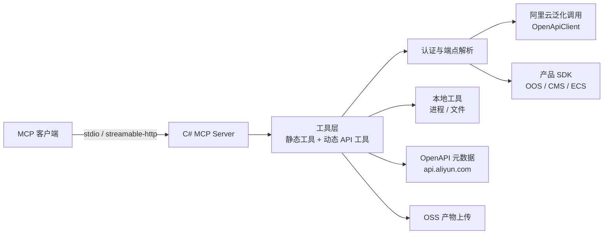

# Alibaba Cloud Ops MCP Server（C# 版）

> 状态：已实现，本机构建与 104 项测试通过；真账号联调未执行。
> 本仓库是 [aliyun/alibaba-cloud-ops-mcp-server](https://github.com/aliyun/alibaba-cloud-ops-mcp-server) v0.9.27（Python，Apache-2.0）的 C# 重写项目，目标为**行为兼容替换**。

## 项目定位

把阿里云 ECS、VPC、RDS、OOS、CMS、OSS 的运维能力封装为 MCP 工具，让 AI 助手通过自然语言完成云资源查询、批量运维与应用部署。C# 版面向需要单一 .NET 运行时、`dotnet tool` 分发或 Docker 部署的环境。

非官方项目。不以上游包名发布，保留 Apache-2.0 LICENSE 与 NOTICE，并在文档中标注修改。

## 目标能力（对齐上游 v0.9.27）

| 模式 | 工具数 | 说明 |
|---|---|---|
| 默认模式 | 40 | 11 个动态 API 工具 + 10 个 OOS + 9 个 CMS + 4 个 OSS + 3 个 LOCAL + 3 个部署工具 |
| `--services ecs,vpc,...` | 44 | 额外注册 4 个元数据/通用调用工具 |
| `--code-deploy` | 7 | 仅部署链路所需工具 |
| `--visible-tools` | 白名单 | 按名称过滤，支持动态 API 工具名 |

上游基线：源码 3,530 行（Python），测试 4,300 行 / 290 个用例。工具清单与统计口径见 [docs/功能/02-功能清单.md](docs/功能/02-功能清单.md)。

## 架构



详细的系统上下文、部署拓扑与运行时链路见 [docs/架构全景图.md](docs/架构全景图.md)。

## 技术栈（版本已于 2026-11-12 核实）

| 层 | 选型 | 版本 |
|---|---|---|
| 运行时 | .NET | 10.0（LTS） |
| MCP | `ModelContextProtocol` | 2.4.0 |
| 云调用（通用） | `AlibabaCloud.OpenApiClient` | 0.2.3 |
| 云调用（产品） | `AlibabaCloud.SDK.Oos20190601` / `Cms20190101` / `Ecs20140526` / `Vpc20160428` / `Rds20140815` | 3.8.0 / 4.0.12 / 7.11.9 / 7.3.2 / 16.0.0 |
| 对象存储 | `AlibabaCloud.OSS.V2` | 0.3.0（0.x，备选 `Aliyun.OSS.SDK.NetCore` 2.14.1） |
| 凭证 | `Aliyun.Credentials` | 1.5.4 |
| 测试 | xUnit + WireMock.Net | 规划中 |

## 目录结构

```
.
├── README.md
├── AGENTS.md
├── Dockerfile
├── LICENSE / NOTICE
├── src/AlibabaCloud.Ops.Mcp.Server/      服务实现
│   ├── Program.cs                        CLI、Host、传输、注册
│   ├── Options/                          9 个启动参数
│   ├── Auth/                             凭证优先级
│   ├── Cloud/                            端点、元数据、泛化调用、OOS 执行器
│   ├── Mcp/                              instructions、动态工具注册、白名单过滤
│   ├── Tools/                            34 个静态工具与部署规则
│   └── Resources/                        PromptUnderstanding 原文
├── tests/AlibabaCloud.Ops.Mcp.Server.Tests/   104 个测试
├── nupkg/                                dotnet tool 打包产物
└── docs
    ├── README.md            文档总索引与目录约定
    ├── 架构全景图.md         系统上下文、部署拓扑、运行时链路
    ├── 功能/                架构、功能清单、术语、限制、选型
    ├── 流程/                按功能点拆分的流程图、时序图、状态机
    └── 需求/0927/           C# 重写需求的五件套、assets/、sql/
```

## 环境要求（规划）

- .NET SDK 10.0 或更高
- 有效阿里云 AccessKey，具备目标资源的操作权限
- Linux 或 macOS（Windows 仅保证构建，`LOCAL_RunShellScript` 语义待验证）

## 快速开始

```bash
# 构建
dotnet build

# stdio 启动
ALIBABA_CLOUD_ACCESS_KEY_ID=<id> \
ALIBABA_CLOUD_ACCESS_KEY_SECRET=<secret> \
dotnet run --project src/AlibabaCloud.Ops.Mcp.Server -- --transport stdio

# HTTP 启动
dotnet run --project src/AlibabaCloud.Ops.Mcp.Server -- \
  --transport streamable-http --host 127.0.0.1 --port 8000

# 打包为 dotnet tool
dotnet pack -c Release -o nupkg
dotnet tool install --tool-path ./tools --add-source ./nupkg AlibabaCloud.Ops.Mcp.Server
```

MCP 客户端配置（本地工具安装后）：

```json
{
  "mcpServers": {
    "alibaba-cloud-ops-mcp-server": {
      "timeout": 600,
      "command": "alibaba-cloud-ops-mcp-server",
      "args": ["--transport", "stdio"],
      "env": {
        "ALIBABA_CLOUD_ACCESS_KEY_ID": "Your Access Key ID",
        "ALIBABA_CLOUD_ACCESS_KEY_SECRET": "Your Access Key Secret"
      }
    }
  }
}
```

## 配置与凭证

优先级：HTTP 请求头 `x-acs-accesskey-id` / `x-acs-accesskey-secret` / `x-acs-security-token` > 环境变量 > `Aliyun.Credentials` 默认凭证链。`--headers-credential-only` 启用后不回退。配置只描述字段，不写入真实凭据。

完整参数见 [docs/需求/0927/0927-CSharp重构云运维MCP服务-实施方案.md](docs/需求/0927/0927-CSharp重构云运维MCP服务-实施方案.md)。

## 测试与质量门禁

```bash
# 单元测试
dotnet test

# 覆盖率
dotnet test --collect:"XPlat Code Coverage" --results-directory ./coverage

# 文档校验
node ~/.agents/skills/requirement-docs/scripts/check-docs.mjs \
  --docs docs/需求 --issue 0927
```

## 文档索引

- [docs/README.md](docs/README.md)：目录约定与总索引
- [docs/架构全景图.md](docs/架构全景图.md)：系统边界与运行时链路
- [docs/功能/02-功能清单.md](docs/功能/02-功能清单.md)：40 个工具的清点口径
- [docs/需求/0927/](docs/需求/0927/)：C# 重写需求五件套

## 已知限制

- 未做真实阿里云账号联调；OSS、CMS、OOS 的实际调用链未验证。
- SSE 传输不支持，`--transport sse` 以退出码 2 报错。
- OSS 使用稳定的 V1 SDK（`Aliyun.OSS.SDK.NetCore` 2.14.1），未采用仍处 0.x 的 V2。
- OOS 与 CMS 固定工具通过泛化调用实现，与上游的强类型 SDK 调用语义一致，但实现路径不同。
- 部署 Bucket 使用确定性命名 `app-{应用名}-code-deploy`，上游为按标签复用的随机命名。
- OSS 工具返回结构化 JSON，上游返回 Python 对象字符串，属已声明差异。
- 上游 `ForeceStop` 拼写与 `--code-deploy` 工具数量差异按兼容口径保留。
- 本机 .NET 安装在 `~/.dotnet`，`dotnet tool install` 后直接运行 apphost 需先设置 `DOTNET_ROOT=$HOME/.dotnet`。

## 安全须知

- `LOCAL_RunShellScript` 可在运行主机执行任意命令，等同于本地代码执行权限。
- `DeleteInstances`、`DeleteBucket`、`ResetPassword`、`ReplaceSystemDisk`、`RunCommand` 具备破坏性。
- 建议使用最小权限 RAM 子账号，并优先通过 `--visible-tools` 收敛工具面。
- HTTP 模式默认绑定 `127.0.0.1`，暴露到网络前必须自行增加鉴权与网络隔离。

## 许可证与归属

上游项目采用 Apache-2.0。本仓库作为衍生作品，保留原始 LICENSE、NOTICE 与版权声明，并在提交与文档中说明修改内容。工具描述与提示词文本来源于上游，保持原样以维持模型行为一致。
