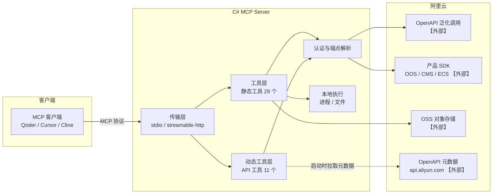
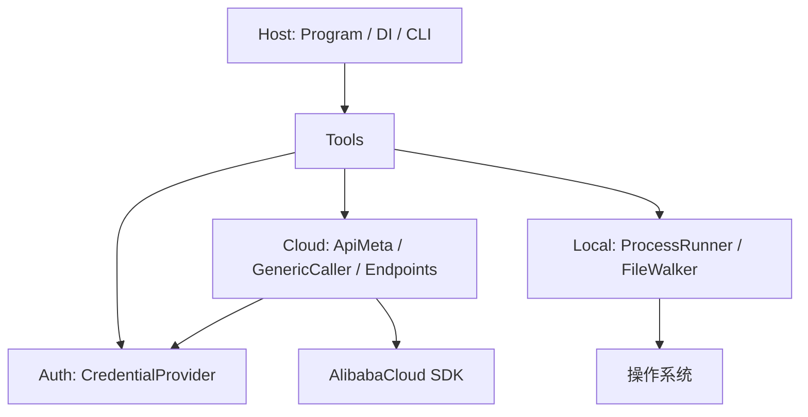
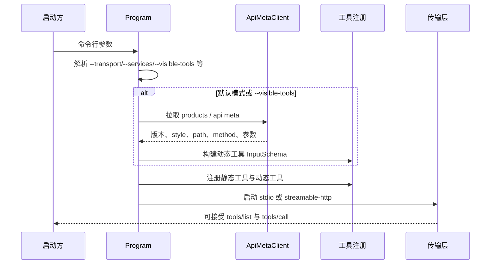

# 01 项目架构

> 文档编号：01
> 状态：已实现，本机构建与测试通过
> 证据基线：上游 v0.9.27（commit 751a8fd）

## 目标

定义 C# 版的服务边界、组件职责、依赖方向与启动顺序。当前无代码，本文件描述**规划架构**；实现完成后按实际代码路径校正。

## 系统上下文



边界说明：

- 本服务不持久化业务数据，唯一本地状态是 `.code_deploy/.application.json` 与 `.code_deploy/release/` 产物目录。
- 阿里云侧全部为外部系统；元数据接口 `https://api.aliyun.com/meta/v1` 为无鉴权 GET，是本服务唯一的非资源类外部依赖。
- 部署到 ECS 的过程由 OOS 模板执行，本服务只负责编排与状态查询，不在目标机常驻。

## 组件职责

| 组件 | 职责 | 关键约束 |
|---|---|---|
| 传输层 | 选择 stdio 或 streamable-http；HTTP 模式读取请求头凭证 | stdio 下 stdout 不得输出日志 |
| 工具层（静态） | 29 个固定工具：OOS 10、CMS 9、OSS 4、LOCAL 3、部署 3 | 描述与参数名对齐上游 |
| 动态工具层 | 按 OpenAPI 元数据生成工具定义；支持 `--extra-config` 与 `--visible-tools` | 启动需可离线降级，元数据失败不得导致全服务不可用 |
| 认证与端点 | 凭证优先级、国内/国际端点、中心化与双端点服务映射 | 不缓存凭证到磁盘；日志脱敏 |
| 本地执行 | 列目录、执行脚本、识别技术栈 | 超时必须杀进程树；路径校验规则待确认 |
| 部署编排 | 应用/分组创建、打标、产物上传、发起部署、轮询状态 | 长任务支持取消与总超时 |

## 依赖方向



规则：

- `Tools` 不直接 `new HttpClient`，统一由 `Cloud` 注入。
- `Auth` 不依赖 `Tools`，避免循环。
- 动态工具层只依赖 `Cloud` 与 `McpServerTool` 基类，不依赖具体静态工具。

## 规划目录

```
alibaba-cloud-ops-mcp-server-cs/
├── src/AlibabaCloud.Ops.Mcp.Server/
│   ├── Program.cs
│   ├── Options/ServerOptions.cs
│   ├── Mcp/ServerInstructions.cs
│   ├── Auth/CredentialProvider.cs
│   ├── Auth/HeaderCredentialAccessor.cs
│   ├── Cloud/EndpointResolver.cs
│   ├── Cloud/ApiMetaClient.cs
│   ├── Cloud/GenericApiCaller.cs
│   ├── Tools/OosTools.cs
│   ├── Tools/CmsTools.cs
│   ├── Tools/OssTools.cs
│   ├── Tools/LocalTools.cs
│   ├── Tools/DeployRules.cs
│   ├── Tools/CodeDeployTool.cs
│   ├── Tools/DynamicApiTool.cs
│   ├── Tools/CommonTools.cs
│   └── Resources/PROMPT_UNDERSTANDING.md
└── tests/AlibabaCloud.Ops.Mcp.Server.Tests/
```

单项目即可支撑约 5k 行规模；只有在需要对外发布类库时才拆分程序集。

## 启动顺序



失败模式：

| 场景 | 预期行为 |
|---|---|
| 元数据接口不可达 | 记录错误，跳过动态工具，静态工具仍可用（当前上游会整体失败，属改进项，需确认） |
| 单个 API 元数据缺失 | 跳过该工具并告警，不影响其他工具 |
| 凭证缺失 | 启动成功，调用时返回明确错误 |
| 端口占用 | 启动失败并返回非零退出码 |

## 外部依赖

| 依赖 | 用途 | 鉴权 | 失败影响 |
|---|---|---|---|
| `api.aliyun.com/meta/v1` | 动态工具 schema、版本、style | 无 | 动态工具不可用 |
| 阿里云 OpenAPI | 资源查询与操作 | AK/SK + 可选 STS | 对应工具调用失败 |
| OSS | 部署产物上传 | AK/SK | CodeDeploy 不可用 |
| OOS | 批量运维与部署编排 | AK/SK | OOS 与部署工具不可用 |

## 与上游的架构差异

| 项 | 上游 Python | C# 规划 |
|---|---|---|
| 动态工具 | `inspect.Signature` + pydantic 运行时生成 | `McpServerTool` 子类 + 手工 JSON Schema |
| 元数据缓存 | 无，每次调用重复请求 | 进程内缓存，按 service/version/api 键 |
| 轮询 | 固定 1s，无总超时 | `TimeProvider` + 取消 + 总超时 |
| 日志 | Python logging 到 stderr | `Microsoft.Extensions.Logging` 到 stderr |
| SSE | 支持 | 首版不支持，待确认 |
| 输出序列化 | 多为对象直接返回 | 统一 JSON，OSS 与 CMS 输出结构差异需评审 |

## 证据索引

| 结论 | 证据 |
|---|---|
| 40 个工具与模块分布 | 上游 `src/alibaba_cloud_ops_mcp_server/tools/*.py`，统计见 `docs/功能/02-功能清单.md` |
| 动态工具机制 | 上游 `tools/api_tools.py`、`alibabacloud/api_meta_client.py` |
| 端点映射规则 | 上游 `tools/api_tools.py` 的 `_get_service_endpoint` |
| 凭证优先级 | 上游 `alibabacloud/utils.py` 的 `create_config` / `get_credentials_from_header` |
| CLI 参数 | 上游 `server.py` 的 click 选项与 `README_mcp_args_zh.md` |

## 待确认

1. 元数据接口不可达时是否降级为"仅静态工具"。
2. SSE 是否提供兼容层。
3. `LOCAL_RunShellScript` 是否增加根目录限制。
