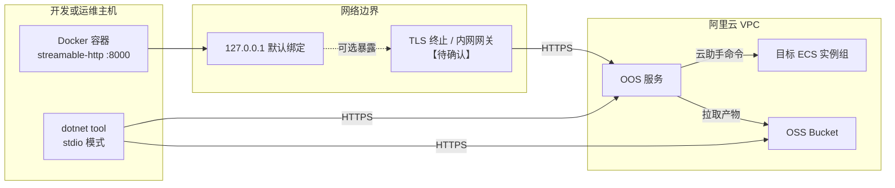
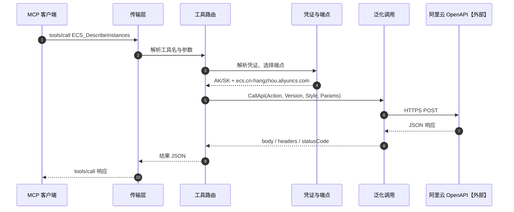
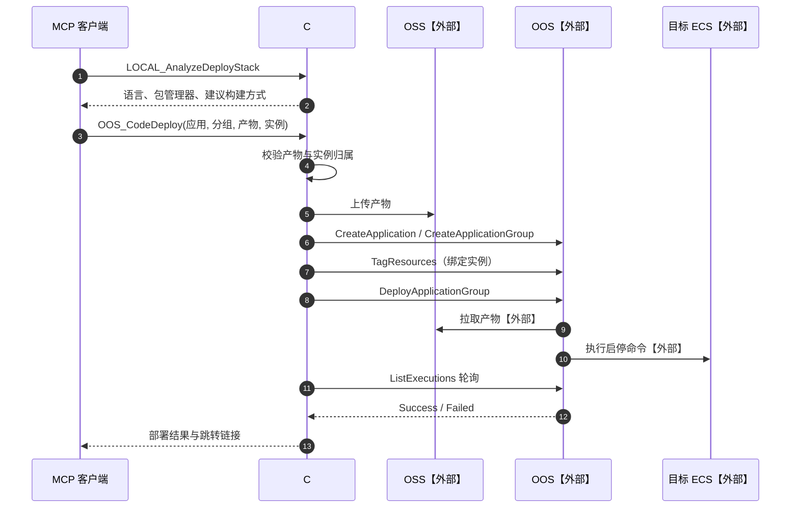

# 架构全景图

> 状态：已实现，与当前代码路径一致 ｜ 基线：上游 v0.9.27 ｜ 关联：[功能/01-项目架构](功能/01-项目架构.md)

本文件只回答三个项目级问题：系统由谁组成、部署在哪里、一次请求如何流动。单个功能的业务分支见 `流程/`。

## 一、系统上下文

```mermaid
flowchart TB
    subgraph 使用者
        U1[运维人员]
        U2[AI 助手 / Agent]
    end

    subgraph 客户端
        CL[MCP 客户端<br/>Qoder / Cursor / Cline]
    end

    subgraph 本服务["C# MCP Server"]
        SV[传输层]
        TL[工具层]
        CLD[阿里云调用层]
        LC[本地执行层]
    end

    subgraph 阿里云【外部】
        META[OpenAPI 元数据<br/>api.aliyun.com]
        API[OpenAPI / 产品接口]
        OSS[OSS]
        OOS[OOS 编排]
        ECS[ECS 目标实例]
    end

    U1 --> U2
    U2 --> CL
    CL -->|stdio / streamable-http| SV
    SV --> TL
    TL --> CLD
    TL --> LC
    CLD --> META
    CLD --> API
    TL --> OSS
    CLD --> OOS
    OOS -->|模板执行| ECS
```

边界说明：

- 本服务不持有业务数据库，唯一本地状态是 `.code_deploy/` 下的部署产物与部署记录。
- ECS 上不常驻本服务组件；OOS 通过云助手在目标实例执行命令。
- 元数据接口仅用于生成工具定义，不参与业务数据流。

## 二、部署拓扑



说明：

- `dotnet tool` 形态不监听端口，由 MCP 客户端拉起子进程。
- Docker 形态默认只映射到宿主机回环地址；暴露到网络前必须补鉴权与网络隔离，当前无内置认证。
- 部署产物由本服务上传到 OSS，OOS 再从 OSS 拉取到目标实例；两者需在同地域或可互通。

## 三、运行时链路

### 3.1 一次工具调用（以查询实例为例）



失败分支：

- 凭证缺失：在调用阿里云前返回错误，不发起请求。
- 元数据缺失：仅影响动态工具注册，不影响已注册工具的调用。
- HTTP 5xx 或限流：按 SDK 重试策略处理，最终以 `isError: true` 返回。

### 3.2 一次代码部署（跨系统）



关键点：

- 应用与分组已存在时跳过创建，不重复建。
- 轮询必须有总超时与取消；上游为固定 1 秒无限轮询。
- 启停命令由规则引擎生成；用户显式提供时优先使用用户值。

## 四、与功能文档的分工

| 内容 | 位置 |
|---|---|
| 组件职责、目录、启动顺序、外部依赖 | [功能/01-项目架构](功能/01-项目架构.md) |
| 工具清单与数量口径 | [功能/02-功能清单](功能/02-功能清单.md) |
| 术语与代码映射 | [功能/03-领域术语](功能/03-领域术语.md) |
| 兼容差异与风险 | [功能/04-已知限制与风险](功能/04-已知限制与风险.md) |
| 单功能分支、状态机、异常路径 | `流程/01` 至 `流程/03` |
