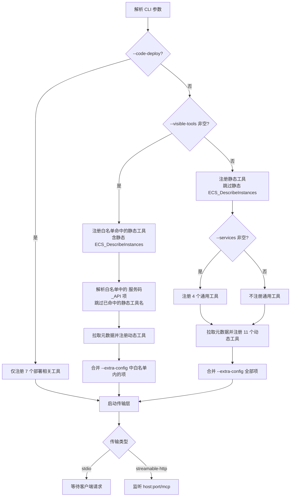
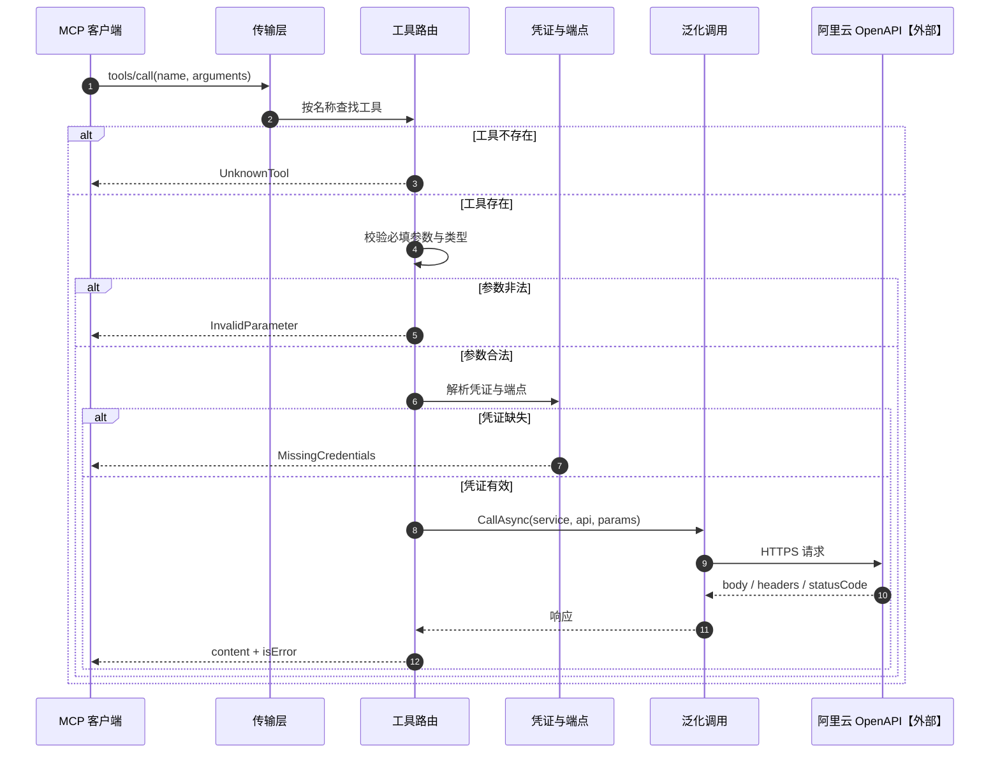

# 01 MCP工具注册与调用（v1）

> 文档编号：01
> 文档版本：v1
> 状态：已实现，stdio 与无状态 HTTP 两种传输的工具面均实测通过
> 证据基线：上游 v0.9.27（commit 751a8fd）

## 目标

说明服务启动时如何决定注册哪些工具，以及一次工具调用如何从客户端到达阿里云。

## 参与角色与前置条件

| 角色 | 职责 |
|---|---|
| MCP 客户端 | 发起 `tools/list` 与 `tools/call` |
| 启动参数 | 决定注册模式与工具白名单 |
| 元数据服务【外部】 | 提供动态工具的名称、参数与 API 元信息 |
| 阿里云 OpenAPI【外部】 | 执行实际资源操作 |

前置条件：服务已解析完 CLI 参数；静态工具已编译进程序集。

## 主流程：工具注册

注册冲突规则：`--code-deploy` 与 `--visible-tools` 同时出现时，前者优先，后者被忽略并记录告警。白名单按名称大小写不敏感匹配静态工具；已命中的静态名称不再参与动态工具解析，因此在白名单模式下 `ECS_DescribeInstances` 使用静态版本的两参数 schema。

实现要点：动态工具与白名单在 `McpServerOptions` 的 PostConfigure 阶段应用；无状态 HTTP 每个请求重建工具集合时按同一规则回填，stdio 只在启动时注册一次。

## 时序：一次工具调用

## 状态机

本功能点无跨请求状态，不需要状态机。

## 关键异常

| 异常 | 触发条件 | 表现 |
|---|---|---|
| 元数据不可达 | `api.aliyun.com` 超时或 5xx | 动态工具缺失，静态工具可用 |
| 单个 API 元数据缺失 | 服务码或 API 名非法 | 跳过该工具并告警 |
| 白名单拼写错误 | 名称不匹配任何工具 | 记录未注册名称 |
| 参数缺省 | 模型漏传必填参数 | `isError: true`，不发起云调用 |
| 传输不支持 | `--transport sse` | 启动失败，退出码 2 |

## 证据索引

| 结论 | 上游证据 |
|---|---|
| 三种注册模式与优先级 | `server.py` 的 `main` 函数 |
| 动态工具生成 | `tools/api_tools.py` 的 `create_api_tools` |
| 元数据接口路径 | `alibabacloud/api_meta_client.py` |
| 静态 `ECS_DescribeInstances` 跳过规则 | `server.py` 普通模式注册循环 |
| 白名单大小写处理 | `_register_tools_with_filter` |

## 实现风险

1. 上游在元数据失败时整体启动失败，C# 版计划降级；该行为差异需确认。
2. 动态工具的 `required` 与 `default` 必须与元数据一致，否则模型行为改变。
3. 白名单模式下动态工具的注册顺序会影响 `tools/list` 顺序，需与上游一致或明确不保证顺序。
