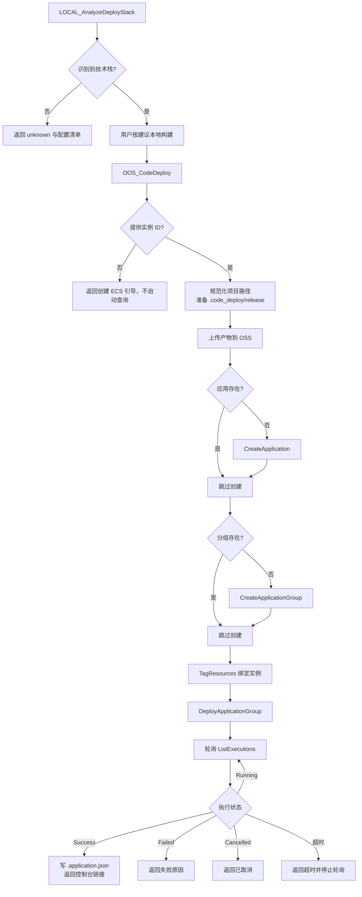
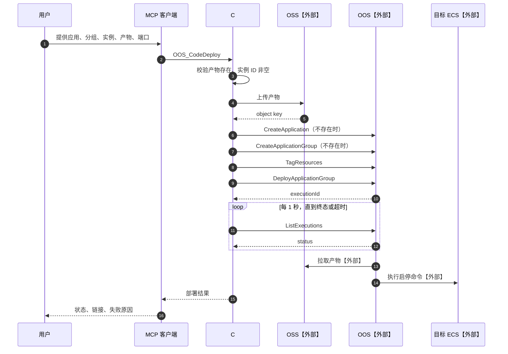
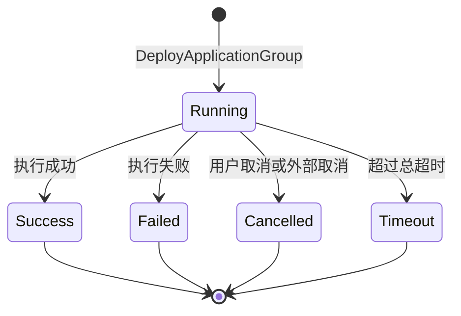

# 02 代码部署全流程（v1）

> 文档编号：02
> 文档版本：v1
> 状态：已实现，本机规则引擎与工具面实测通过
> 证据基线：上游 v0.9.27（commit 751a8fd）

## 目标

说明从本地项目识别到 ECS 部署完成的完整业务链路，包括前置条件、状态迁移与失败路径。

## 参与角色与前置条件

| 角色 | 职责 |
|---|---|
| 用户 | 提供应用名、分组名、实例 ID、产物路径、监听端口 |
| MCP 客户端 | 依次调用识别、构建、部署工具 |
| C# MCP Server | 校验参数、上传产物、编排 OOS、轮询状态 |
| OSS【外部】 | 存放部署产物 |
| OOS【外部】 | 创建应用与分组、打标、发起部署 |
| ECS【外部】 | 执行启停命令，运行应用 |

前置条件：

1. 目标 ECS 实例已存在，且用户明确提供实例 ID。
2. 本地已生成部署产物（压缩包或可执行文件）。
3. AK 具备 OOS、ECS、OSS 权限。

## 主流程

## 时序

## 状态机

`Timeout` 是 C# 版新增的客户端侧状态，上游没有；上游会一直轮询。

## 关键异常

| 异常 | 触发条件 | 处理 |
|---|---|---|
| 产物不存在 | `file_path` 无效 | 部署前报错，不调用 OSS |
| 未提供实例 | `instance_ids` 为空 | 返回创建 ECS 引导链接 |
| 实例不存在或不属于当前账号 | TagResources 失败 | 返回 OOS 错误码 |
| 应用或分组同名 | 已存在 | 跳过创建，继续部署 |
| 上传失败 | OSS 权限或网络问题 | 返回上传错误，不发起部署 |
| 启动命令错误 | 规则生成或用户自定义有误 | 执行失败，返回 statusMessage |
| 客户端取消 | 用户中断 | 停止轮询；已发起的 OOS 执行不自动回滚 |

## 证据索引

| 结论 | 上游证据 |
|---|---|
| 部署步骤与顺序 | `tools/application_management_tools.py` 的 `OOS_CodeDeploy` |
| 应用/分组存在性检查 | `_check_application_exists`、`_check_application_group_exists` |
| 打标逻辑 | `_ensure_instances_tagged`、`_tag_multiple_instances` |
| 轮询与终态 | `_start_execution_sync`、`END_STATUSES` |
| 启停命令规则 | `_generate_start_command_by_rules`、`_generate_stop_command_by_rules` |
| 状态文件 | `.code_deploy/.application.json` 的读写逻辑 |

## 实现风险

1. 规则引擎约 900 行，移植漂移会直接导致部署失败，必须先移植测试。
2. 禁用交互式命令（`unzip -o`、`tar -xzf`），否则 OOS 执行会卡住。
3. 启动命令必须后台运行并重定向日志，否则 OOS 会等待前台进程。
4. 上游轮询无总超时；C# 版必须加超时并把超时状态暴露给客户端。
