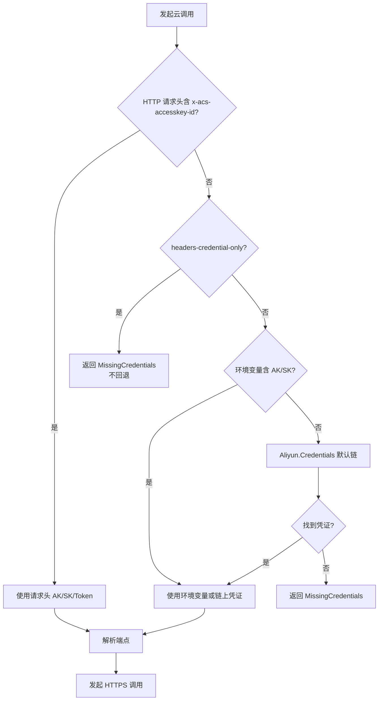
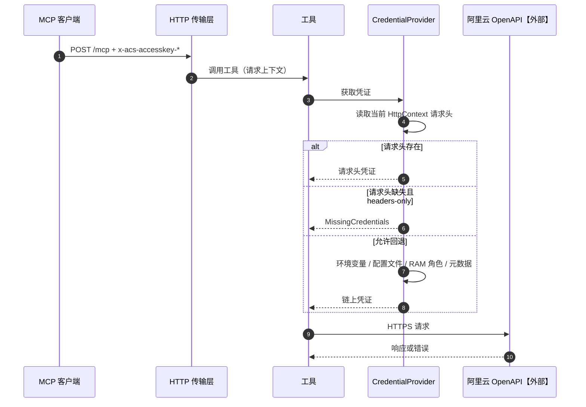

# 03 凭证与端点解析（v1）

> 文档编号：03
> 文档版本：v1
> 状态：已实现，优先级与端点映射均有单元测试
> 证据基线：上游 v0.9.27（commit 751a8fd）

## 目标

说明一次阿里云调用前，凭证从哪里取、失败时是否回退，以及目标服务的端点如何确定。

## 参与角色与前置条件

| 角色 | 职责 |
|---|---|
| MCP 客户端 | HTTP 模式下可提供请求头凭证 |
| 运行环境 | 提供环境变量或实例元数据身份 |
| 凭证提供器 | 按优先级解析凭证 |
| 端点解析器 | 按服务码、地域、环境选择域名 |

前置条件：工具已通过参数校验，准备发起云调用。

## 主流程：凭证优先级



凭证优先级：请求头 → 环境变量 → `Aliyun.Credentials` 默认链；`--headers-credential-only` 只接受请求头。默认链内部顺序为环境变量 → 配置文件 → RAM 角色 → 实例元数据，具体变量与文件格式由 `Aliyun.Credentials` 负责，本服务不重复实现。

## 主流程：端点选择

```mermaid
flowchart TD
    A[service, region, --env] --> B{service 是 bssopenapi?}
    B -->|是| C{"--env=international?"}
    C -->|是| C1[business.ap-southeast-1.aliyuncs.com]
    C -->|否| C2{region 在国内白名单?}
    C2 -->|是| C3[business.aliyuncs.com]
    C2 -->|否| C4[business.ap-southeast-1.aliyuncs.com]
    B -->|否| D{service 属于中心化 cbn/ros/ram?}
    D -->|是| D1[{service}.aliyuncs.com]
    D -->|否| E{service 属于区域级 ecs/oos/vpc/slb?}
    E -->|是| E1[{service}.{region}.aliyuncs.com]
    E -->|否| F{service 属于双端点?}
    F -->|是| F1{region 在白名单?}
    F1 -->|是| F2[{service}.aliyuncs.com]
    F1 -->|否| F3[{service}.{region}.aliyuncs.com]
    F -->|否| G[{service}.{region}.aliyuncs.com]
```

## 时序：HTTP 请求头凭证



## 状态机

本功能点无持久状态。凭证不缓存到磁盘；进程内是否缓存由 SDK 决定。

## 关键异常

| 异常 | 触发条件 | 处理 |
|---|---|---|
| 请求头只给 ID 不给 Secret | 头不完整 | 视为无请求头凭证；headers-only 时报错 |
| STS 过期 | Token 失效 | 返回阿里云鉴权错误，不自动刷新 |
| 凭证链无可用凭证 | 无环境变量、无角色 | `MissingCredentials` |
| 地域与服务不匹配 | 用了国际站账号但 `--env domestic` | 阿里云返回鉴权或域名错误 |
| 自定义服务未收录 | `--extra-config` 中的新服务 | 走默认 `{service}.{region}.aliyuncs.com` |

## 证据索引

| 结论 | 上游证据 |
|---|---|
| 请求头字段名 | `alibabacloud/utils.py` 的 `get_credentials_from_header` |
| headers-only 语义 | `utils.py` 的 `create_config` 与 `settings.py` |
| 默认凭证链 | `create_config` 中的 `CredClient()` |
| 端点分类与白名单 | `tools/api_tools.py` 的 `_get_service_endpoint`、`DOUBLE_ENDPOINT_SERVICE`、`CENTRAL_SERVICE_ENDPOINTS` |
| `--env` 作用范围 | `server.py` 对 `settings.env` 的赋值 |

## 实现风险

1. HTTP 传输下若取不到 `HttpContext`，请求头凭证失效；需 M0 验证。
2. 端点大小写：上游对 service 与 region 做 `lower()`；C# 必须保持一致，否则白名单匹配失败。
3. 元数据中 `RegionId` 缺省为 `cn-hangzhou`，会影响端点选择与调用结果。
4. 国际站与国内站 AK 不通用，错误信息可能误导，需在文档中提示。
